# Relief Load-and-Route Planner — Phase II Report

**Course:** CSEG3053 Design and Analysis of Algorithms
**Project 13:** Disaster Relief Supply Distribution Platform
**Student:** Siddhant Sharma, Roll No. / SAP ID 590023054 (individual project)
**Date:** 21 November 2026

---

## Contents

1. Problem statement
2. Changes since Phase I
3. System workflow
4. Algorithms and pseudocode
5. Correctness reasoning
6. Complexity analysis and comparison
7. Theory: merge sort recurrence and NP-hardness of 0/1 knapsack
8. Empirical evaluation
9. Testing
10. Working product (screenshots)
11. Limitations and reflection
12. How to build and run

---

## 1. Problem statement

**Target user.** A relief coordinator at a district warehouse after a flood or
earthquake. They have a list of shelters, the supplies each shelter has asked for,
a handful of trucks and a road map that may have damaged roads.

**Need.** Decide quickly, and in a way that can be defended later:

- which supply packages go on each truck (trucks have a weight limit),
- which shelter each truck serves (help should be spread out, most urgent first),
- which road each truck takes (shortest open route, avoiding damaged roads),

and know how much better a careful plan is than a quick rule of thumb.

**Inputs.**

| Input | Fields | Rules |
|---|---|---|
| Shelter | ID, name, population, urgency, road node | urgency 1–10; population ≥ 0; node exists |
| Package | ID, supply type, weight (kg), need severity, shelter ID | weight > 0; severity 1–10; shelter exists |
| Vehicle | ID, capacity (kg), available | capacity > 0; available 0/1 |
| Road | node A, node B, distance (km) | distance > 0; no self-loops |
| Depot | road node of the warehouse | node exists |

Inputs come from a scenario CSV file (four provided) or from the Manual Entry screen.

**Derived value.** Relief value of a package = shelter urgency × need severity
(unchanged from Phase I). A medicine package (severity 10) for an urgency-9 clinic
is worth 90; blankets (severity 3) for an urgency-5 shelter are worth 15.

**Outputs.**

- Per vehicle: shelter, load weight / capacity, relief value, distance, route, package IDs.
- Per shelter: distance or UNREACHABLE, value requested, value delivered, % fulfilled.
- Totals: value, weight, packages sent and pending; fairness (worst and average shelter %).
- Cost: time, operation count, extra memory.
- Side-by-side comparison of DP, Greedy and Branch & Bound on the same input.
- CSV reports: `plan.csv`, `routes.csv`, `comparison.csv`, `benchmark.csv`.

**Constraints.** Offline, C17, standard library only. Up to 100 road nodes,
50 shelters, 500 packages, 30 vehicles. Packages are indivisible (0/1).
One dispatch round: each available vehicle makes one trip to one shelter.

**Success criteria.**

1. No vehicle is ever loaded above its capacity; no package is delivered twice.
2. DP and Branch & Bound always give the optimal load for a vehicle
   (checked against brute force on 180 random instances).
3. A closed road changes the route at once; a cut-off shelter is reported as
   UNREACHABLE and no vehicle is sent there.
4. Invalid input never crashes the program and is reported with a reason
   (and a line number for files).
5. The 413-package scenario plans with all three algorithms in well under 5 seconds.

---

## 2. Changes since Phase I

| Area | Phase I | Phase II |
|---|---|---|
| Scope | One shelter, one vehicle, typed in | Many shelters, vehicles and roads from a scenario file; manual entry kept |
| Loading algorithms | DP, Greedy | DP, Greedy, **Least-cost Branch & Bound** |
| Greedy sort | Selection sort, O(n²), float ratios | **Merge sort** O(n log n), ratio value/weight as a double, with explicit tie-breaks |
| Routing | None | **Dijkstra** on the road network; road closure and reopening; unreachable shelters |
| Lookup | Linear | **Binary search** over a sorted shelter-ID index |
| Planning | Fill one vehicle | Shelter priority, largest vehicle first, fairness rule, per-shelter fulfilment |
| Data | Keyboard only | CSV loader with line-numbered errors; four datasets incl. 413-package stress and a greedy trap |
| Evaluation | One comparison screen | Benchmark runner: size sweep, capacity sweep, adversarial; CSV export |
| Measurement | Time | Time, operation counters per algorithm, auxiliary memory |
| Safety | Basic range checks | Validation module, DP table limit (25 M cells), B&B node limit (2 M), EOF-safe input |
| Testing | 4 manual test cases | 4 automated test programs, 161 checks, brute-force oracle |
| Code | 5 files, 646 lines | 15 modules + `main.c`, layered (UI → planning → algorithms → foundation) |

All four Phase I test cases still produce their expected output (Section 9.1).

---

## 3. System workflow

```
                  ┌──────────────────────────┐
                  │ Load scenario (CSV) or   │
                  │ Manual Entry (keyboard)  │
                  └────────────┬─────────────┘
                               │ validate every record (line numbers on error)
                               ▼
                  ┌──────────────────────────┐
                  │ Scenario: shelters,      │  relief value = urgency × severity
                  │ packages, vehicles, roads│  merge sort shelter IDs → binary search index
                  └────────────┬─────────────┘
                               │ (optional) close / reopen roads
                               ▼
  ┌────────────────────────── PLAN OPERATION ─────────────────────────────┐
  │ 1. Dijkstra from depot → distance + route to every node              │
  │    shelters with no open path → UNREACHABLE                           │
  │ 2. Merge sort shelters by urgency, population, ID (priority)         │
  │    Merge sort vehicles by capacity, largest first                     │
  │ 3. For each available vehicle:                                        │
  │      target = reachable shelter with pending load this vehicle can    │
  │               carry, fewest vehicles so far (ties → priority)         │
  │      load   = KNAPSACK(pending packages of target, capacity)          │
  │               using DP | Greedy | Branch & Bound                      │
  │      mark loaded packages delivered; record route                    │
  │ 4. Summarise: totals, per-shelter fulfilment, fairness, cost          │
  └───────────────────────────────┬───────────────────────────────────────┘
                                  ▼
         Print plan  ·  Compare all three algorithms  ·  Export CSV
```

Benchmarks run separately on generated data (fixed seeds) and call the three
knapsack algorithms directly.

---

## 4. Algorithms and pseudocode

Notation: items `1..n` with integer `weight[i] > 0`, `value[i] ≥ 0`, capacity `W`.

### 4.1 0/1 Knapsack — Dynamic Programming (primary, from Phase I)
`src/knapsack_dp.c`

```
KNAPSACK-DP(weight, value, n, W)
    if (n+1)(W+1) > MAX_DP_CELLS: return LIMIT_ERROR
    for w = 0..W: dp[0][w] = 0
    for i = 1..n:
        for w = 0..W:
            dp[i][w] = dp[i-1][w]                         // exclude item i
            if weight[i] ≤ w:
                dp[i][w] = max(dp[i][w],
                               value[i] + dp[i-1][w - weight[i]])   // include
    // backtrack
    w = W
    for i = n down to 1:
        if dp[i][w] ≠ dp[i-1][w]:
            selected[i] = 1; w = w - weight[i]
    return dp[n][W]
```

### 4.2 Greedy by value/weight (fast baseline)
`src/knapsack_greedy.c`

```
KNAPSACK-GREEDY(weight, value, n, W)
    order = [1..n]
    MERGE-SORT(order) by ratio value/weight, descending
        // ratio = value / weight
        // ties: higher value first, then lower index
    room = W; total = 0
    for each i in order:
        if weight[i] ≤ room:
            selected[i] = 1; room -= weight[i]; total += value[i]
    return total
```

### 4.3 Least-cost Branch and Bound (exact alternative)
`src/knapsack_bb.c`

```
UPPER-BOUND(level, value, weight)                 // fractional relaxation
    bound = value; room = W - weight
    for k = level .. n-1 in ratio order while room > 0:
        if weight[k] ≤ room: room -= weight[k]; bound += value[k]
        else: bound += value[k] · room / weight[k]; room = 0
    return bound

PROMISING(bound, best) = floor(bound) > best     // values are integers

KNAPSACK-BB(weight, value, n, W)
    order = items merge-sorted by ratio (as in greedy)
    best = 0; bestNode = none
    root = (level 0, value 0, weight 0, bound UPPER-BOUND(0,0,0))
    push root on a MAX-HEAP keyed by bound          // best-first ("least cost")
    while heap not empty:
        node = POP-MAX(heap)
        if node.level = n: continue                 // leaf
        if not PROMISING(node.bound, best): prune; continue
        item = order[node.level]
        if node.weight + weight[item] ≤ W:          // child: include
            c = (level+1, value+value[item], weight+weight[item], parent=node, taken=1)
            c.bound = UPPER-BOUND(c)
            if c.value > best: best = c.value; bestNode = c
            if PROMISING(c.bound, best): push c else prune
        c = (level+1, node.value, node.weight, parent=node, taken=0)   // exclude
        c.bound = UPPER-BOUND(c)
        if PROMISING(c.bound, best): push c else prune
        if nodes created > MAX_BB_NODES: return LIMIT_ERROR
    follow parent links from bestNode, marking taken items
    return best
```

Nodes live in a growable arena and keep a parent index, so the chosen set is
rebuilt without storing a full selection vector in every node.

### 4.4 Dijkstra (shortest routes, re-run after road damage)
`src/graph.c`

```
DIJKSTRA(G, source)                         // adjacency matrix, V ≤ 100
    for v in V: dist[v] = ∞; parent[v] = -1; done[v] = false
    dist[source] = 0
    repeat V times:
        u = undone vertex with minimum dist        // linear scan
        if u = none or dist[u] = ∞: break          // rest unreachable
        done[u] = true
        for v in V with road (u,v) present and NOT closed and not done[v]:
            if dist[u] + d(u,v) < dist[v]:
                dist[v] = dist[u] + d(u,v); parent[v] = u
    return dist, parent

BUILD-PATH(parent, source, target): follow parent from target back to source, reverse
```

Closing a road sets a `closed` flag instead of deleting it, so it can be reopened
with its original length.

### 4.5 Merge sort over indices (stable)
`src/sort_search.c`

```
MERGE-SORT(order[lo..hi), compare)
    if hi - lo ≤ 1: return
    mid = (lo + hi) / 2
    MERGE-SORT(order[lo..mid)); MERGE-SORT(order[mid..hi))
    MERGE: repeatedly take the smaller head; on a tie take the LEFT one (stability)
```

Used three times: greedy/B&B ratio order, shelter priority, vehicle order
(and to build the sorted shelter-ID index).

### 4.6 Binary search (shelter lookup by ID)
`src/sort_search.c`, used by `findShelter` in `src/relief_model.c`

```
BINARY-SEARCH(sortedIds, n, key)
    lo = 0; hi = n - 1
    while lo ≤ hi:
        mid = lo + (hi - lo) / 2
        if sortedIds[mid] = key: return mid
        if sortedIds[mid] < key: lo = mid + 1 else hi = mid - 1
    return NOT_FOUND
```

### 4.7 Dispatch planner (combines the above)
`src/relief_planner.c`

```
PLAN-OPERATION(scenario, algorithm)
    dist, parent = DIJKSTRA(roads, depot)
    reachable[s] = dist[node(s)] < ∞
    shelterOrder = MERGE-SORT(shelters) by urgency ↓, population ↓, ID ↑
    vehicleOrder = MERGE-SORT(vehicles) by capacity ↓
    visits[s] = 0 for all s
    for v in vehicleOrder, if available:
        target = none
        for s in shelterOrder:
            if reachable[s] and s has an undelivered package with weight ≤ cap(v):
                if target = none or visits[s] < visits[target]: target = s
        if target = none: continue
        visits[target]++
        items = undelivered packages of target
        load = KNAPSACK-<algorithm>(items, cap(v))
        mark load delivered; record route BUILD-PATH(parent, depot, node(target))
    compute totals, per-shelter fulfilment, min and average fulfilment
```

---

## 5. Correctness reasoning

### 5.1 DP is optimal
*Subproblem.* `dp[i][w]` = best value using only items `1..i` with capacity `w`.

*Optimal substructure.* Take an optimal set `S` for `(i, w)`. If item `i ∉ S`,
`S` is optimal for `(i-1, w)`; otherwise `S \ {i}` is optimal for
`(i-1, w - weight[i])` — if a better set existed there, adding `i` would beat `S`,
a contradiction. Hence
`dp[i][w] = max(dp[i-1][w], value[i] + dp[i-1][w-weight[i]])` (second term only when `weight[i] ≤ w`).

*Induction.* Base row `dp[0][w] = 0` is correct (no items). If row `i-1` is correct,
the recurrence makes row `i` correct. So `dp[n][W]` is the optimum.

*Backtracking.* `dp[i][w] ≠ dp[i-1][w]` means the optimum at `(i, w)` cannot be
achieved without item `i`, so it is taken and `w` drops by its weight. Each step
keeps a consistent optimal solution, so the reconstructed set has value `dp[n][W]`.

### 5.2 Branch and Bound is optimal
*Bound validity.* For a node that has decided items `0..level-1`, `UPPER-BOUND`
solves the **fractional** knapsack on the remaining items in ratio order. The
fractional problem is a relaxation of the 0/1 problem (every 0/1 completion is also a
fractional completion), and greedy-by-ratio is optimal for the fractional problem
(exchange argument). Therefore bound ≥ value of every 0/1 completion of that node.

*Safe pruning.* All values are integers, so any completion has value
≤ `floor(bound)`. If `floor(bound) ≤ best`, no completion can beat the incumbent, and
discarding the node loses no better solution.

*Completeness.* Every node is either expanded (both children generated) or pruned
by the rule above; leaves terminate. So every 0/1 assignment is either visited or
proven no better than `best`. `best` is updated whenever an include-child improves
it, so at termination `best` is the optimum. Best-first order (max-heap on bound)
does not affect correctness — only how quickly good incumbents are found.

*Limit.* If the arena would exceed 2 M nodes the function returns
`KNAP_ERR_LIMIT` instead of a possibly wrong answer.

### 5.3 Greedy is not optimal (and why it is still useful)
Counter-example (the greedy trap, `data/adversarial_greedy.csv`, capacity 100,
shelter urgency 10): Oxygen 51 kg severity 10 → value 100 (ratio 1.96),
Water A and Water B 50 kg severity 9 → value 90 each (ratio 1.80). Greedy takes Oxygen first, then nothing else fits: **100**.
Optimal is both waters: **180**. Greedy is still a valid, feasible load computed in
O(n log n), and on random data it is within 0–5 % of optimal (Section 8).

### 5.4 Dijkstra is correct
*Invariant.* When a vertex `u` is marked `done`, `dist[u]` equals the shortest
open-road distance from the depot.

*Proof sketch.* Suppose `u` is the first vertex marked done with a wrong
`dist[u]`. Take a true shortest path to `u`; let `y` be its first vertex not done
and `x` its predecessor (done, so correct). When `x` was finalised, edge `(x,y)` was
relaxed, so `dist[y]` ≤ true distance to `y` ≤ true distance to `u` (road lengths
are positive) < `dist[u]`. Then `y`, not `u`, would have been chosen — contradiction.

Closed roads are skipped during relaxation, so distances are shortest over the
**open** network; vertices never chosen keep `∞` and are reported UNREACHABLE.

### 5.5 Merge sort and binary search
Merge sort: by induction on length — the two halves are sorted, and merge
repeatedly outputs the smaller head, so the output is sorted; taking the left
element on ties keeps equal keys in original order (stable).
Binary search: invariant "if `key` is present, it lies in `[lo, hi]`"; each step
halves the range while keeping the invariant; empty range ⇒ not present.

### 5.6 Planner invariants
Each vehicle's load comes from a knapsack call with that vehicle's capacity, so
capacity is never exceeded; packages are marked `delivered` once loaded and only
undelivered packages are offered later, so none is sent twice; only reachable
shelters are chosen. These invariants are asserted for every scenario × algorithm in
`tests/test_planner.c`.

The **overall** plan is not guaranteed globally optimal: vehicles are assigned one
after another (a heuristic). Only each individual load is optimal (with DP / B&B).

---

## 6. Complexity analysis and comparison

n = packages in the call, W = capacity, V = road nodes, S = shelters, K = vehicles,
P = packages in the scenario.

| Algorithm | Time | Auxiliary space | Optimal | Best when |
|---|---|---|---|---|
| Knapsack DP | Θ(nW) | Θ(nW) (full table for backtracking) | Yes | W moderate; guaranteed answer needed |
| Greedy | Θ(n log n) | Θ(n) | No | Speed matters; many items; rough answer is fine |
| Branch & Bound | O(2ⁿ) worst; typically near O(n log n + n·nodes) | O(nodes) | Yes | Random/uncorrelated data, large W |
| Dijkstra (matrix) | Θ(V²) | Θ(V) | Yes | Dense small graphs (V ≤ 100) |
| Merge sort | Θ(n log n) all cases | Θ(n) | — | Stable ordering needed |
| Binary search | O(log n) | O(1) | — | Repeated lookups by ID |
| Planner | O(V² + S log S + K log K + K·(S·P + knapsack)) | O(V + P) + knapsack | No (heuristic) | — |

**Why DP is "pseudo-polynomial".** Θ(nW) is polynomial in the *value* of W but
exponential in the number of bits used to write W. Doubling the truck size doubles
DP's time and memory (Graph 3); it does not affect greedy.

**Measured trade-off (from `results/benchmark.csv`).**

| Case | DP | Greedy | B&B |
|---|---|---|---|
| n = 1000, W = 12 481 | 35 ms, 47.7 MB, optimal | 0.11 ms, 8 KB, −0.005 % | 0.78 ms, 72 KB, optimal |
| n = 200, W = 5 000 | 2.9 ms, 3.8 MB | 0.01 ms | 0.11 ms |
| Greedy trap (n = 3) | 180 | 100 (−44.4 %) | 180 |
| Correlated n = 40 | 0.03 ms, 78 KB | −2.8 % | **20.4 ms, 119 533 ops, 4.0 MB** |

Conclusion: no single algorithm wins everywhere. DP is predictable but its memory
grows with W; greedy is fastest but can lose a lot on crafted data; B&B is usually
the best of both but explodes when item ratios are all similar.

---

## 7. Theory

### 7.1 Merge sort recurrence (Master Theorem)

T(n) = 2T(n/2) + cn, T(1) = c.

a = 2, b = 2, f(n) = Θ(n), and n^(log_b a) = n^(log₂2) = n.
f(n) = Θ(n^(log_b a)) ⇒ **Case 2** ⇒ **T(n) = Θ(n log n)**.

Recursion-tree check: log₂n levels, each level merges n elements in total ⇒ cn·log₂n.

### 7.2 0/1 Knapsack is NP-hard (reduction from Subset Sum)

*Decision version (KNAP).* Given items (wᵢ, vᵢ), capacity W and target V: is there a
subset with Σw ≤ W and Σv ≥ V?

*KNAP ∈ NP.* A certificate is the subset; checking both sums takes O(n).

*Subset Sum ≤ₚ KNAP.* Given integers s₁..sₙ and target t, build items with
wᵢ = vᵢ = sᵢ, W = t, V = t. This takes O(n) time.

- If some subset sums to exactly t, it has Σw = t ≤ W and Σv = t ≥ V ⇒ YES.
- If KNAP says YES, the subset has Σs ≤ t and Σs ≥ t ⇒ Σs = t ⇒ Subset Sum YES.

Subset Sum is NP-complete, so KNAP is NP-complete and the optimisation problem is
NP-hard. Hence no polynomial algorithm is expected; DP's Θ(nW) is not a
contradiction because it is pseudo-polynomial (Section 6). This is why the project
keeps three approaches: an exact pseudo-polynomial one (DP), an exact exponential one
with pruning (B&B), and a fast approximate one (greedy).

---

## 8. Empirical evaluation

All data is generated in `src/benchmark.c` with fixed xorshift32 seeds, so every run
is reproducible. Each row is verified: `Correct = 1` means the returned selection
fits the capacity and adds up to the returned value; `Optimal` is the DP answer, and
`GapPercent` compares against it. Fast runs are repeated (up to 200 times / 50 ms)
and averaged so the timer can resolve them. Raw data: `results/benchmark.csv` (51 rows).
Timing machine: _<CPU, RAM, Windows 11, GCC 15.1 -O2>_.

**Profiles.** *Random*: weights 1–50 kg, values 1–100, W = half the total weight
(the hardest middle ground). *Correlated*: value = weight + 10 (all ratios similar),
W = half the total weight. *GreedyTrap*: one 51 kg item worth 100, every other item
50 kg worth 90, W = 100.

### Graph 1 — Time vs n (size sweep)
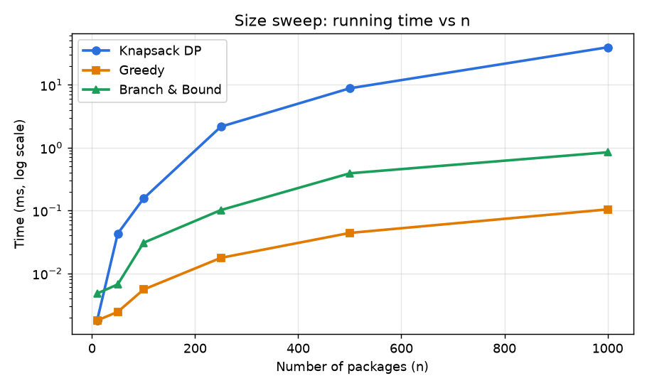

DP rises fastest because W grows with n, so cells = n·W grow roughly as n²
(1 200 → 12.5 M cells). Greedy follows n log n. B&B stays close to greedy on random
data because the fractional bound prunes almost everything.

### Graph 2 — Memory vs n
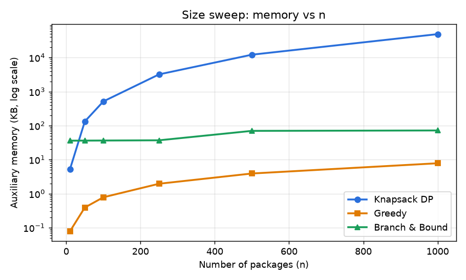

DP's table reaches 47.7 MB at n = 1000; B&B ~72 KB; greedy 8 KB.

### Graph 3 — Time vs capacity (n = 200)
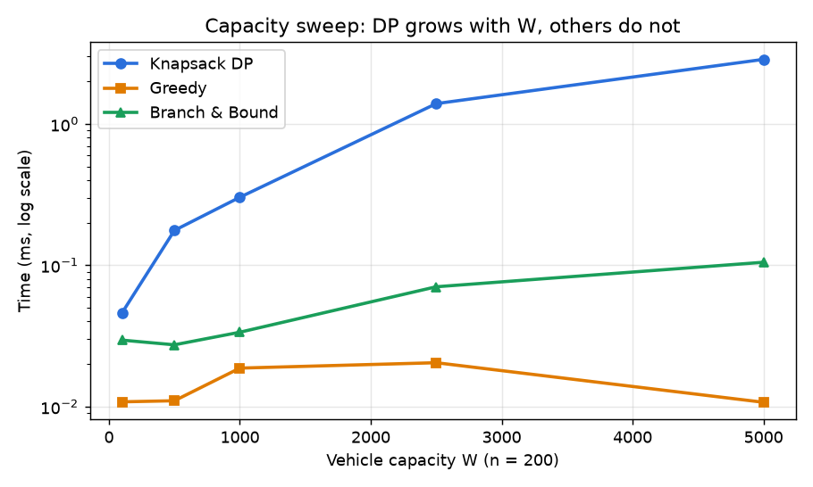

Only DP depends on W: 0.05 ms at W = 100 → 2.9 ms at W = 5000 (cells 20 000 → 1 M,
linear in W). Greedy and B&B are flat — evidence for the pseudo-polynomial bound.

### Graph 4 — Counted operations vs n
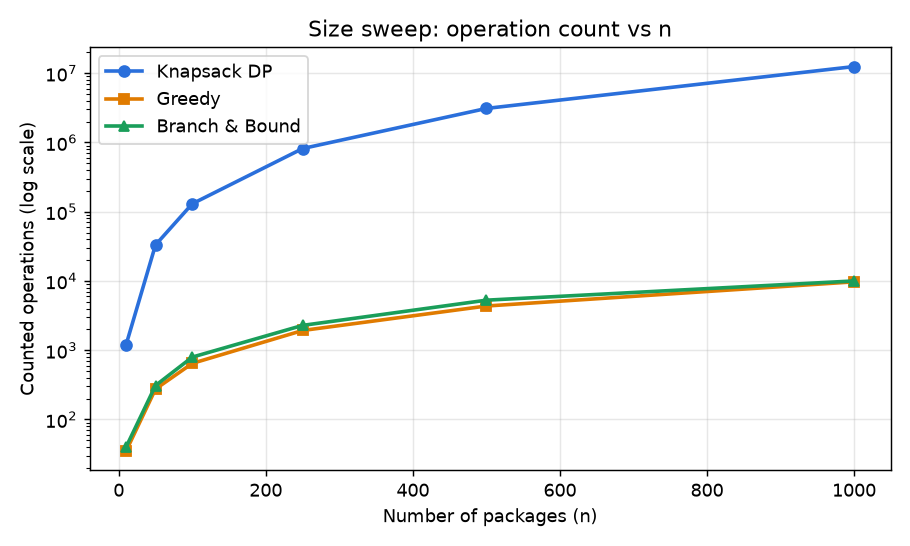

Operation counts follow the same shape as time, so the timing trend is not noise.

### Graph 5 — Greedy loss on adversarial data
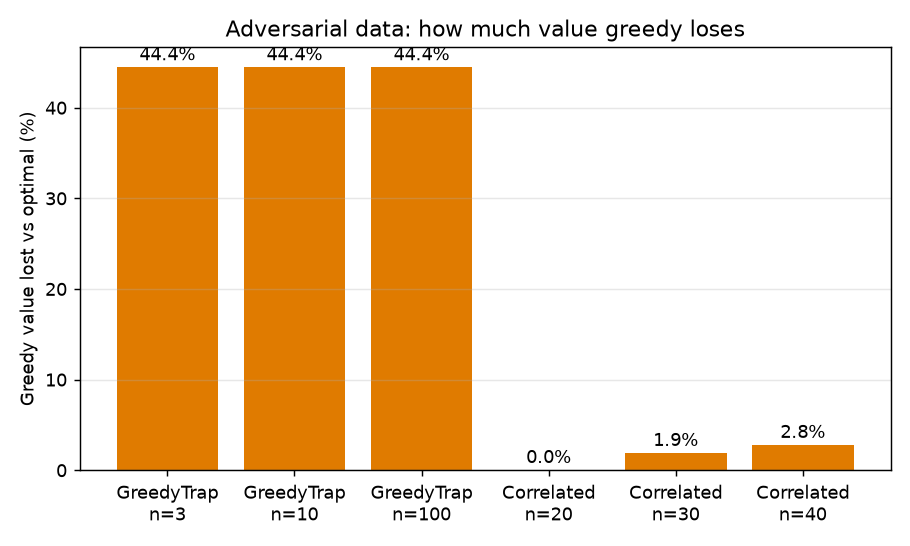

Greedy loses 44.4 % on the trap at every size, and 1.9–2.8 % on correlated data.

### Graph 6 — Branch & Bound worst case
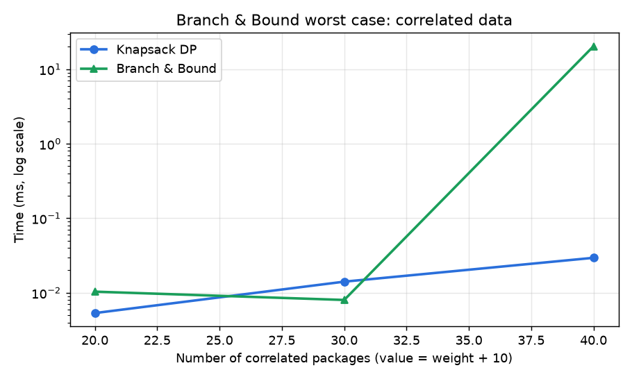

With value = weight + 10 every item looks alike, the bound prunes little and B&B
explores 119 533 nodes at n = 40 (20 ms, ~700× DP). At n = 200 it hits the
2 M-node safety limit while DP still answers (`tests/test_stress.c`).

### Graph 7 — Scenario results
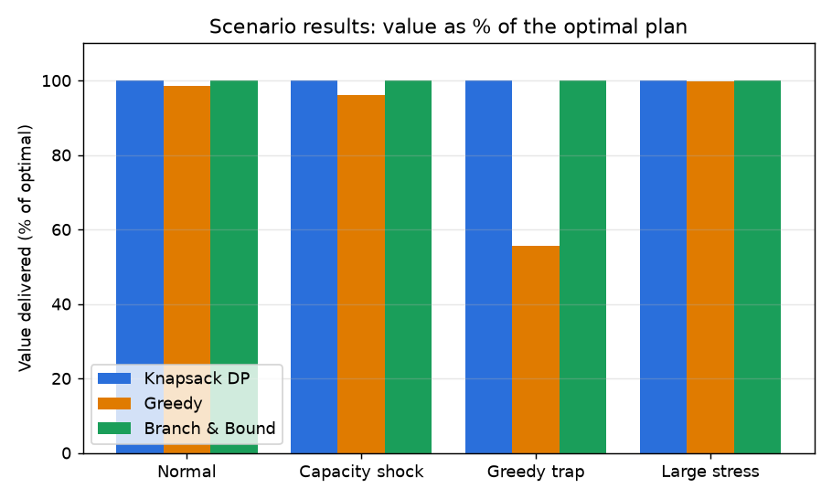

| Scenario | DP | Greedy | B&B | Greedy gap | Notes |
|---|---|---|---|---|---|
| Normal (5 shelters, 28 pkgs, 4 trucks) | 952 | 938 | 952 | 1.5 % | Market Hall gets nothing: 4 trucks for 5 shelters |
| Capacity shock (3 roads cut, 1 truck down) | 758 | 728 | 758 | 4.0 % | One shelter UNREACHABLE; gap grows as capacity shrinks |
| Greedy trap file | 180 | 100 | 180 | 44.4 % | Worst-shelter fulfilment 64.3 % vs 35.7 % |
| Large stress (40 shelters, 413 pkgs, 25 trucks) | 6551 | 6540 | 6551 | 0.2 % | All three finish in < 1 ms |

**Road damage experiment (Normal).** Closing road 4–6 reroutes the City Stadium
truck from 0 → 2 → 4 → 6 (13 km) to 0 → 1 → 3 → 6 (16 km); reopening restores 13 km.
The load does not change; only the route does.

### City maps — Normal and Shock scenarios
Schematic layout (not to scale); every road shows its real length in km. Coloured
lines are the truck routes of the DP plan. Drawn by `tools/draw_city_map.py`.

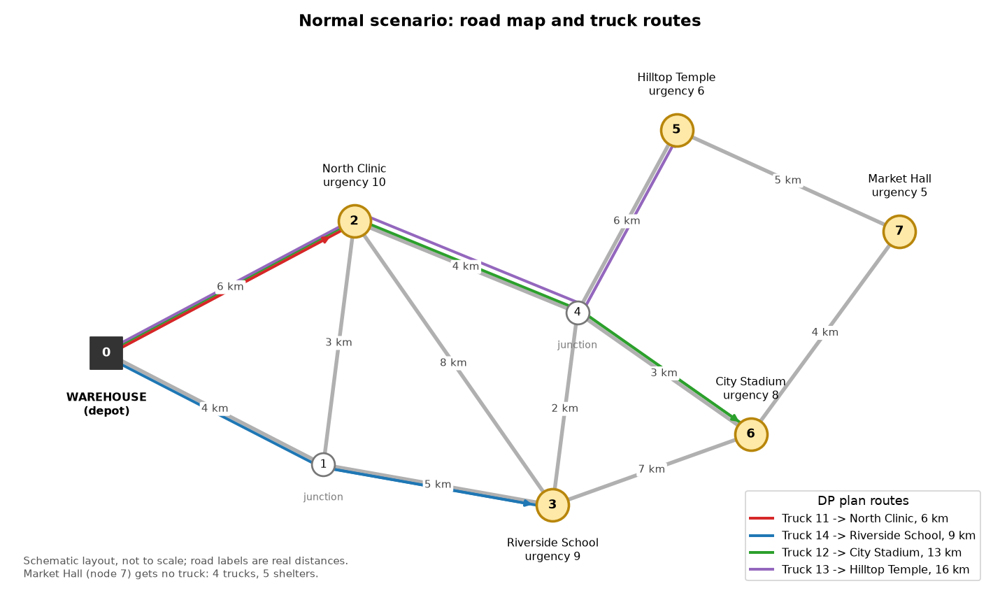

Node 0 is the warehouse; nodes 1 and 4 are road junctions; the other five nodes are
shelters. Three of the four routes share the 0–2 road, because North Clinic is the
gateway to the east of the map.

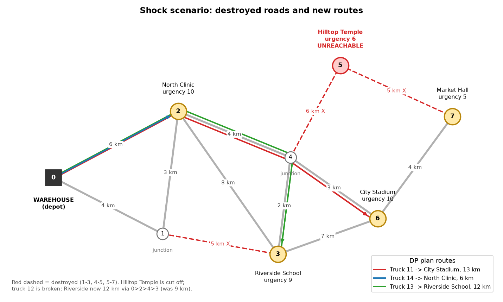

Roads 1–3, 4–5 and 5–7 are destroyed (red dashed). Hilltop Temple loses both of its
roads and becomes UNREACHABLE; Riverside School is now reached via 0 → 2 → 4 → 3
(12 km instead of 9 km).

---

## 9. Testing

### 9.1 Phase I test cases re-run in Phase II (Manual Entry, menu 7)

| # | Input | Expected (Phase I) | Actual (Phase II) | Result |
|---|---|---|---|---|
| 1 Normal | Urgency 9; Medicine 10 kg sev 10, Water 20 kg sev 7, Food 30 kg sev 8; W = 40 | DP: Medicine + Food, 40 kg, remaining 0, value 162 | DP: Medicine + Food, 40/40 kg, value 162. B&B: same. Greedy: Medicine + Water, 153 | Pass |
| 2 Adversarial | Urgency 10; Medicine 10 kg sev 6, Water 20 kg sev 10, Food 30 kg sev 10; W = 50 | Greedy: Medicine + Water, 30 kg, 160. DP: Water + Food, 50 kg, 200 | Greedy: Medicine + Water, 30/50 kg, 160. DP: Water + Food, 50/50 kg, 200. B&B: 200. Gap 20.0 % | Pass |
| 3 Boundary (exact fit) | Urgency 10; Medicine 20 kg sev 10; W = 20 | Medicine, 20 kg, remaining 0, value 100 | All three: Medicine, 20/20 kg, value 100 | Pass |
| 4 Invalid (nothing fits) | Urgency 8; packages 10/20/30 kg; W = 5 | None selected, 0 kg, remaining 5, value 0 | All three: nothing selected, 0/5 kg, value 0 | Pass |

The original Phase I program (`Phase_1/src/relief.exe`, option 3 "Compare Both")
was also re-run on the same four inputs and gives the expected result in every case:

| # | Phase I program — Greedy | Phase I program — DP |
|---|---|---|
| 1 | Medicine + Water, 30 kg, remaining 10, value 153 | Medicine + Food, 40 kg, remaining 0, value 162 |
| 2 | Medicine + Water, 30 kg, remaining 20, value 160 | Water + Food, 50 kg, remaining 0, value 200 |
| 3 | Medicine, 20 kg, remaining 0, value 100 | Medicine, 20 kg, remaining 0, value 100 |
| 4 | None, 0 kg, remaining 5, value 0 | None, 0 kg, remaining 5, value 0 |

Phase II adds invalid-input cases that Phase I lacked (urgency 0 / 11, weight 0,
malformed files — tests T9–T14 below), because test case 4 is really a boundary case
(nothing fits) rather than invalid input.

### 9.2 Automated test suite — `mingw32-make check`

| Program | Checks | Result |
|---|---|---|
| `test_algorithms` | 32 | 32 passed |
| `test_planner` | 68 | 68 passed |
| `test_edge_cases` | 45 | 45 passed |
| `test_stress` | 16 | 16 passed |
| **Total** | **161** | **161 passed, 0 failed** |

### 9.3 Test-case table (selected)

| ID | Category | Input | Expected | Actual |
|---|---|---|---|---|
| T1 | Correctness | 180 random instances, n = 1–15, random + correlated | DP = B&B = brute force; greedy ≤ optimum; selections feasible | All match |
| T2 | Correctness | Greedy trap 51/100, 50/90, 50/90, W = 100 | DP 180, B&B 180, greedy 100 | 180 / 180 / 100 |
| T3 | Sorting | Equal keys in merge sort | Original order kept (stable) | Stable |
| T4 | Search | Binary search present / absent ID | Index / not found | Correct |
| T5 | Graph | Close a road on the shortest path | Longer detour; reopen restores | 13 km → 16 km → 13 km |
| T6 | Boundary | Capacity 0 | Nothing loaded, value 0 | 0 |
| T7 | Boundary | Single package exactly fits / 1 kg too heavy | Taken / not taken | As expected |
| T8 | Boundary | Every package too heavy | Value 0 | 0 |
| T9 | Invalid | Weight 0, negative value, negative n or W | Rejected (`KNAP_ERR_INPUT`) | Rejected |
| T10 | Limit | DP table above 25 M cells | Refused (`KNAP_ERR_LIMIT`) | Refused |
| T11 | Validation | Urgency 0 / 11, severity 0, availability 2, capacity 0, self-loop road, negative distance | Rejected | Rejected |
| T12 | File | Missing file | "not found" reported, old scenario kept | As expected |
| T13 | File | Non-numeric weight on line 7 | Error message names "Line 7" | "Line 7 …" |
| T14 | File | Missing column / unknown shelter / duplicate ID / unknown node / unknown section / 0 nodes / no vehicles | Rejected with reason | Rejected |
| T15 | Planning | Island shelter (no road), higher urgency | Marked UNREACHABLE; truck sent to reachable shelter | As expected |
| T16 | Planning | All roads closed | Empty plan, every package pending | As expected |
| T17 | Planning | Package heavier than every truck | No vehicle sent for it | As expected |
| T18 | Planning | All scenarios × all algorithms | Capacity never exceeded; no package twice; routes valid | Holds |
| T19 | Fairness | Normal scenario | 4 trucks → 4 different shelters | As expected |
| T20 | Stress | n = 1000 random | All finish < 5 s; B&B = DP; greedy faster | DP 35 ms, B&B 0.8 ms |
| T21 | Stress | 413-package scenario, 3 full plans | < 5 s; DP = B&B | < 1 ms each, 6551 = 6551 |
| T22 | Stress | B&B on 200 correlated | Optimal or node-limit error, no crash, < 5 s | Node limit reached, no crash |
| T23 | Stability | 50 repeated B&B runs, n = 300 | Same answer each time | Same |
| T24 | UI | Letters, out-of-range, blank, end of input | Re-prompt; clean exit on EOF | As expected (screenshot 13) |

---

## 10. Working product (screenshots)

Images are renderings of real program output captured from `build/relief.exe`; the
full text of each run is in `docs/screenshots/transcripts/`.
_(Replace with your own window screenshots if your evaluator requires them.)_

| # | Screen | File |
|---|---|---|
| 1 | Main menu | 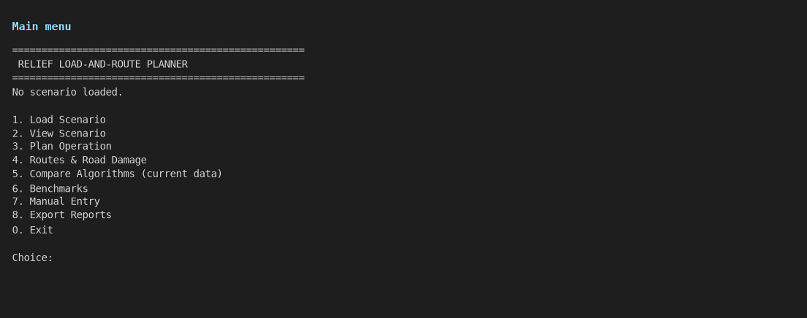 |
| 2 | Load Normal scenario | 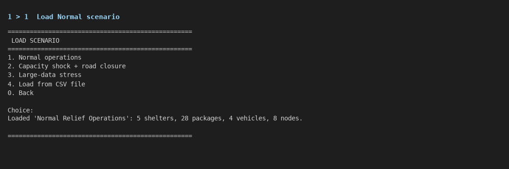 |
| 3 | View shelters | 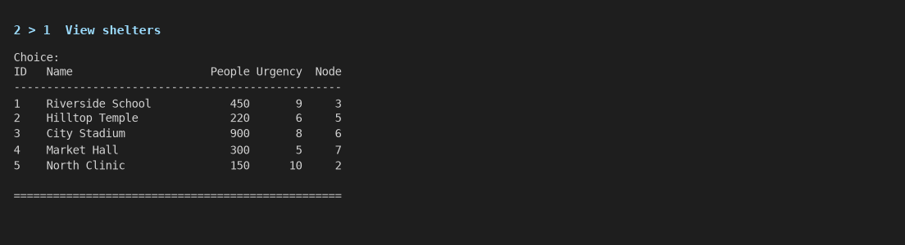 |
| 4 | View road network | 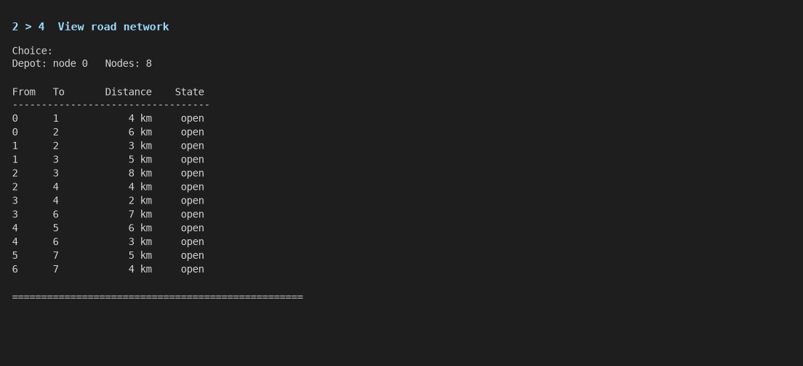 |
| 5 | Plan with DP | 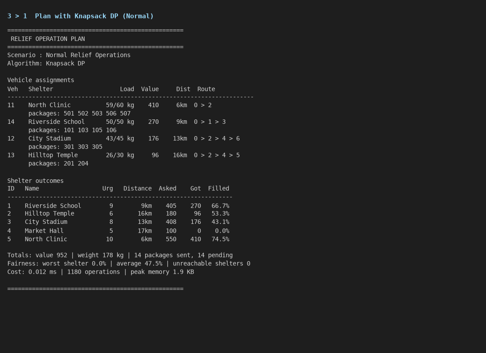 |
| 6 | Compare (Normal) | 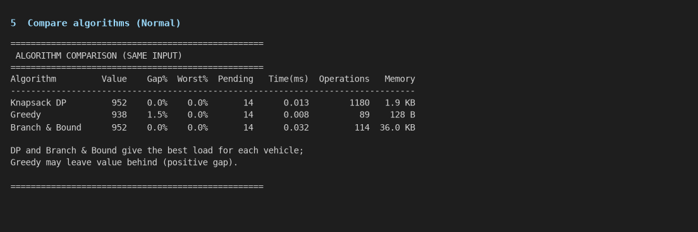 |
| 7 | Close road, re-plan, reopen | 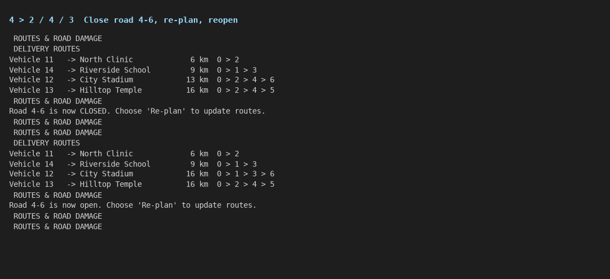 |
| 8 | Compare (Capacity shock) | 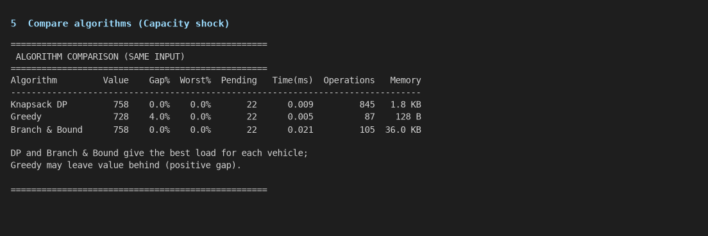 |
| 9 | Compare (Greedy trap) | 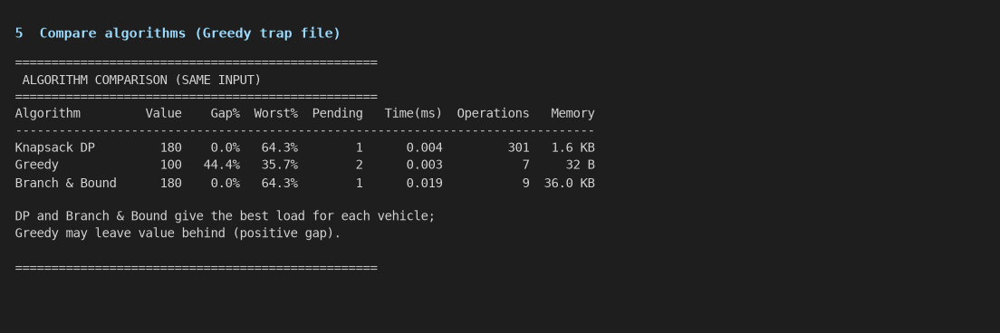 |
| 10 | Compare (Large stress) |  |
| 11 | Benchmarks | 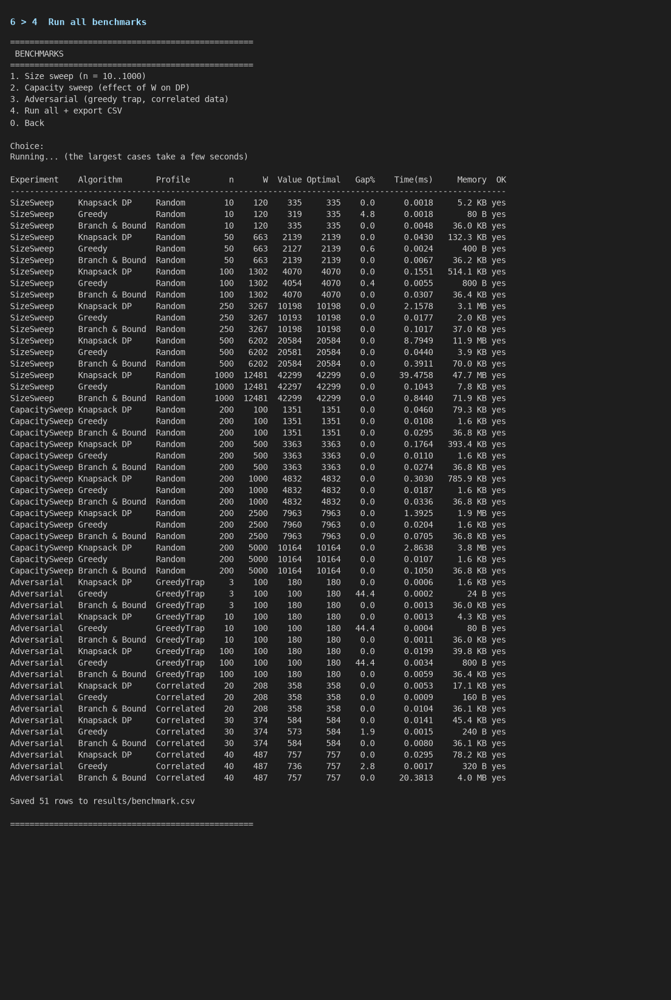 |
| 12 | Manual entry | 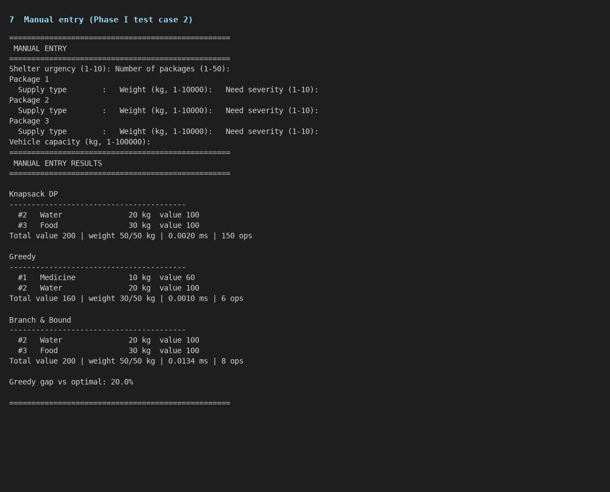 |
| 13 | Invalid input rejected | 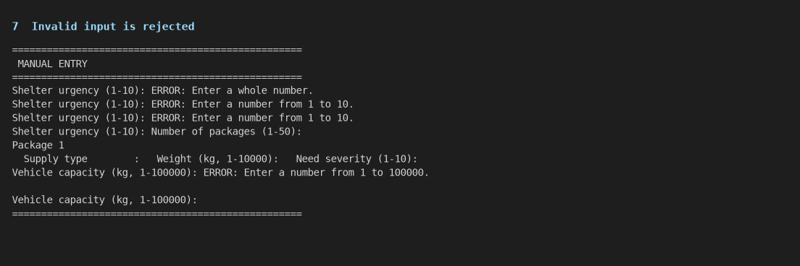 |
| 14 | Export reports | 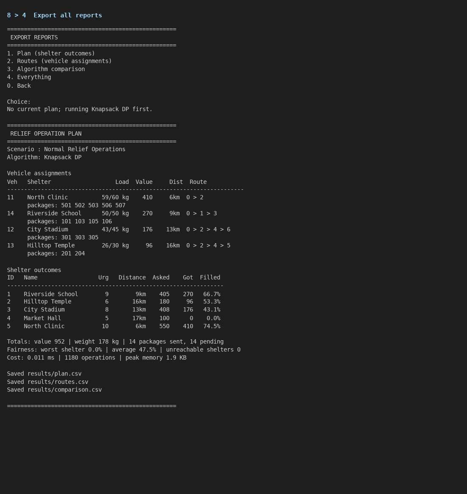 |

---

## 11. Limitations and reflection

**Limitations**

1. **One dispatch round.** Each vehicle makes one trip to one shelter; there is no
   multi-trip scheduling or multi-stop routing.
2. **Plan is not globally optimal.** Vehicles are assigned one by one (largest
   first, fairness rule). Each load is optimal, but a different vehicle–shelter
   pairing could deliver more in total.
3. **DP memory grows with n × W.** The full table is kept for backtracking; tables
   above 25 M cells are refused. A 1-D table would save memory but lose the selection.
4. **B&B is exponential in the worst case.** On correlated data it can hit the
   2 M-node limit (n = 200) while DP still answers.
5. **Static roads.** Distances are fixed kilometres; no travel time, traffic,
   one-way roads or road capacity.
6. **Single unit.** Weight only (kg); volume and refrigeration are not modelled.
7. **Dijkstra uses an O(V²) matrix.** Fine for V ≤ 100; a heap-based version would
   be needed for city-scale maps.

**Reflection**

- *Algorithm choice depends on data, not just Big-O.* B&B beat DP by 45× on
  n = 1000 random data and lost by ~700× on 40 correlated items. Benchmarks on
  adversarial data were essential to see this.
- *Pseudo-polynomial is a real limit.* The capacity sweep showed DP time and memory
  growing linearly with W while greedy and B&B stayed flat.
- *Greedy is "usually close", not "always close".* 0.2–1.5 % gap on realistic data,
  44 % on a three-item trap.
- *Fairness changes outcomes.* The first planner sent every truck to the most urgent
  shelter. Adding the fewest-visits rule spread help to four shelters and raised the
  Normal total from 883 to 952.
- *Testing against brute force and limits* found problems that hand-made examples
  did not: B&B on 200 correlated items hits its node limit (so the limit, not a
  crash, is now the tested behaviour), and two wrong test expectations (merge-sort
  tie order, the line number of a CSV error) were corrected after tracing the code.

**Future work:** multi-trip scheduling (vehicle returns to depot), a global
vehicle–shelter assignment (e.g. Hungarian method or ILP for small cases),
space-optimised DP with Hirschberg-style reconstruction, heap-based Dijkstra,
travel-time weights.

---

## 12. How to build and run

```powershell
cd "phase_2(b)"
mingw32-make          # builds build/relief.exe
mingw32-make run      # starts the program
mingw32-make check    # runs all 161 tests
```

Suggested demo: 1→1 (load Normal) · 3→1 (plan DP) · 5 (compare) · 4→2 close 4–6,
4→4 re-plan · 1→2 + 5 (shock) · 1→4 `data/adversarial_greedy.csv` + 5 · 7 (manual) ·
6→4 (benchmarks) · 8→4 (export).

Regenerate graphs: run 6→4 to refresh `results/benchmark.csv`, then rebuild the
charts in Excel or with any plotting tool from that file.
